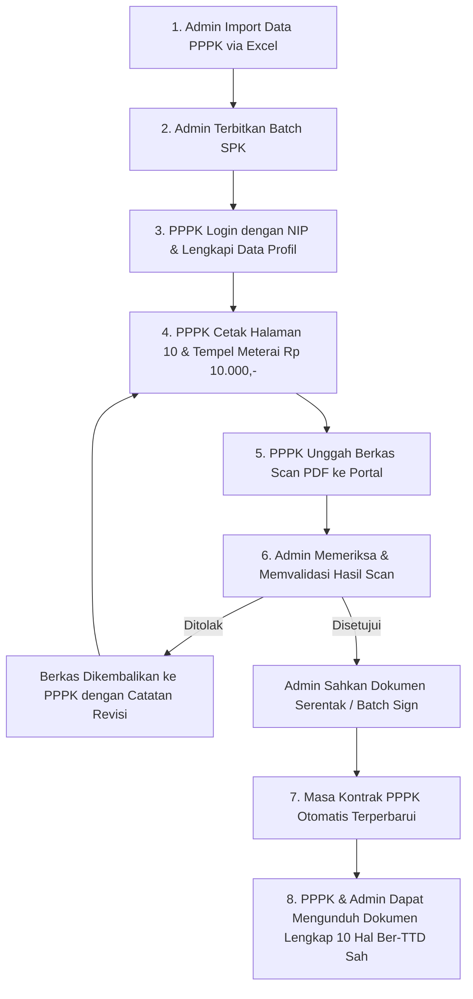

<p align="center">
  
</p>

<h1 align="center">E-SPK PPPK DIGITAL TNI AL</h1>

<p align="center">
  <strong>Sistem Informasi Elektronik Surat Perjanjian Kerja Pegawai Pemerintah dengan Perjanjian Kerja (PPPK)</strong><br />
  Dinas Administrasi Personel Angkatan Laut (Disminpersal) &bull; Tentara Nasional Indonesia Angkatan Laut
</p>

<p align="center">
  
  
  
  
  
</p>

---

## 📌 Tentang E-SPK

**E-SPK PPPK Digital** adalah platform modern berbasis web yang dikembangkan khusus untuk mengotomasi, mengelola, dan mengesahkan dokumen **Surat Perjanjian Kerja (SPK)** bagi seluruh personel Pegawai Pemerintah dengan Perjanjian Kerja (PPPK) di lingkungan **Tentara Nasional Indonesia Angkatan Laut (TNI AL)**.

Sistem ini menggantikan proses administratif manual menjadi alur digital terpadu dengan standar dokumen resmi dinas militer: mulai dari import data massal Excel, penerbitan batch SPK, penandatanganan fisik bermeterai tempel Rp 10.000,- oleh pegawai, hingga verifikasi dan pembubuhan tanda tangan resmi digital Kadisminpersal oleh Administrator.

---

## ✨ Fitur Utama

### 👨‍💼 Panel Administrator (Disminpersal)
- **Dashboard Eksekutif**: Monitoring metrik status SPK secara waktu-nyata (*Terdaftar*, *Menunggu TTD PPPK*, *Menunggu Validasi SPK*, dan *SPK Selesai/Sah*).
- **Manajemen Data PPPK & Kontrak**: Pengelolaan data master seluruh pegawai, filter status profil, serta pencarian instan (NIP, Nama, Jabatan, Unit Kerja).
- **Import Massal Excel**: Kemudahan import ribuan data PPPK secara sekaligus melalui berkas template XLSX.
- **Penerbitan SPK Kolektif (Batch Generator)**:
  - Penomoran Surat SPK otomatis/custom.
  - Pengaturan Nomor & Tanggal Keputusan Menteri Pertahanan (Kepmenhan) yang independen.
  - Pengaturan masa kerja kontrak (TMT Awal & TMT Akhir).
  - Seleksi pegawai target SPK secara fleksibel.
- **Verifikasi & Validasi SPK**:
  - Pratinjau langsung berkas scan PDF meterai & tanda tangan fisik PPPK.
  - Pembubuhan tanda tangan pengesahan secara massal (*Batch Validation / Signing*).
  - Pengembalian/penolakan berkas disertai alasan tertulis yang jelas bagi PPPK.
- **Pengaturan SPK & Master TTD**: Konfigurasi identitas pejabat pengesah (Nama, Pangkat, Jabatan Kadisminpersal) dan tanda tangan transparan digital resolusi tinggi.
- **Kelola Akun & Reset Password**: Pengelolaan kredensial akun personel dan fitur reset password darurat.

### 👤 Portal Personel PPPK
- **Dashboard Mandiri**: Ringkasan status masa berlaku kontrak, tahapan proses SPK aktif, dan riwayat dokumen legal.
- **Pembaruan Profil Pegawai (Pihak Kedua)**: Pengisian data pribadi resmi (Tempat/Tanggal Lahir, Pendidikan, Alamat, Jabatan, dan Unit Kerja).
- **Penampil Dokumen SPK Interaktif (10 Halaman)**:
  - Pratinjau format standar naskah dinas 10 halaman lengkap sesuai regulasi Mabesal / Kemhan.
  - Format tanggal baku bahasa Indonesia pada seluruh klausul perjanjian.
  - Tombol **Cetak Halaman 10**: Cetak lembar pengesahan khusus untuk ditempel meterai fisik Rp 10.000,- dan ditandatangani basah.
  - Unggah hasil scan PDF lembar bermeterai dengan validasi batas ukuran file.
  - Tombol **Cetak Dokumen Lengkap (10 Halaman)** & Unduh PDF Scan Berkas Sah setelah divalidasi.
- **Riwayat Kontrak**: Arsip seluruh dokumen SPK yang pernah diterbitkan beserta unduhan berkas bertandatangan lengkap.

---

## 🔄 Alur Proses Bisnis Digital SPK



---

## 🛠️ Tumpukan Teknologi (Tech Stack)

| Komponen | Teknologi |
| :--- | :--- |
| **Framework Utama** | [Next.js 16](https://nextjs.org/) (App Router Architecture) |
| **Library Antarmuka** | [React 19](https://react.dev/) + TypeScript (Strict Mode) |
| **Styling & Desain** | [Tailwind CSS v4](https://tailwindcss.com/) + CSS Variables Theme Tokens |
| **Komponen UI Primitif**| [Base UI](https://base-ui.com/) + CVA (Class Variance Authority) |
| **Basis Data & Autentikasi** | [Supabase](https://supabase.com/) (PostgreSQL + RLS + GoTrue Auth) |
| **Penyimpanan Berkas** | Supabase Storage (Bucket S3 API: `signatures` & `scans`) |
| **Pemrosesan PDF** | `@react-pdf/renderer` + `pdf-lib` (Document Merging & Watermarking) |
| **Internasionalisasi (i18n)** | `next-intl` (Mendukung ID, EN, AR, ES, DE) |
| **Validasi Skema Form** | `react-hook-form` + `zod` |

---

## 🔒 Keamanan & Perlindungan Sesi

- **Session Hardening**: Masa aktif sesi dibatasi maksimal **1 jam (3600 detik)** dengan mekanisme *Auto Logout* dan *Destroy Session* di server.
- **Anti-Back / BF-Cache Prevention**: Header `Cache-Control: no-store, no-cache, must-revalidate` pada seluruh route terproteksi mencegah akses kembali saat tombol *Back* browser ditekan setelah keluar.
- **Role-Based Access Control (RBAC)**: Proteksi lapis ganda di tingkat Middleware Next.js (`proxy.ts`), Server Route Handlers, dan PostgreSQL Row Level Security (RLS).
- **Service Role Bypass**: Endpoint administratif terisolasi hanya dapat dijalankan oleh Service Role Key server-side.

---

## 🚀 Panduan Memulai (Getting Started)

### Prasyarat
- **Node.js** >= `20.9.0`
- **npm** >= `10.0.0`
- Akun atau instansi **Supabase** (Cloud atau Self-hosted)

### 1. Kloning Repositori
```bash
git clone https://github.com/ekosanto2008/E-SPK.git
cd E-SPK
```

### 2. Instalasi Dependensi
```bash
npm install
```

### 3. Konfigurasi Variabel Lingkungan
Salin file `.env.example` menjadi `.env.local` dan isi kredensial Supabase Anda:
```env
NEXT_PUBLIC_SUPABASE_URL=https://your-project.supabase.co
NEXT_PUBLIC_SUPABASE_ANON_KEY=your-anon-key
SUPABASE_SERVICE_ROLE_KEY=your-service-role-key
```

### 4. Setup Database Supabase
Jalankan skrip migrasi SQL yang disediakan pada dashboard Supabase SQL Editor:
- Lokasi skrip: [`supabase/migrations/001_initial_schema.sql`](supabase/migrations/001_initial_schema.sql)

### 5. Menjalankan Server Pengembangan
```bash
npm run dev
```
Buka peramban Anda di [http://localhost:3000](http://localhost:3000).

### 6. Membangun untuk Produksi
```bash
npm run build
npm run start
```

---

## 📁 Struktur Direktori Proyek

```
E-SPK/
├── public/                     # Aset statis publik, logo resmi, dan vektor
│   └── images/vector/          # Logo resmi Disminpersal & Mabesal
├── src/
│   ├── app/
│   │   ├── [locale]/           # Routing berbasis locale (next-intl)
│   │   │   ├── (admin)/        # Shell halaman kerja dengan Sidebar & Header
│   │   │   │   ├── admin/      # Halaman modul Administrator (Dashboard, PPPK, SPK, Settings, Users)
│   │   │   │   └── pppk/       # Halaman modul Personel PPPK (Dashboard, Profil, SPK, Riwayat)
│   │   │   └── (full-width)/   # Halaman otentikasi login & error pages
│   │   └── api/                # Next.js Server Route Handlers (Auth, SPK Batch, Sign, Import, Upload)
│   ├── components/             # Komponen antarmuka modular
│   │   ├── admin/              # Komponen operasional Admin (PPPK table, SPK validation, Settings)
│   │   ├── pppk/               # Komponen operasional PPPK (SPK 10 Halaman viewer, PDF generator, form)
│   │   └── ui/                 # Primitif UI design system (Button, Dialog, Table, Field, Input, dll.)
│   ├── layout/                 # Komponen layout induk (Sidebar dinamis, Header, User Dropdown)
│   ├── lib/                    # Supabase Client, Server, Admin helper, dan PDF processing engine
│   ├── utils/                  # Utilitas formatting tanggal bahasa Indonesia, class merger, dll.
│   └── proxy.ts                # Next.js Server Middleware (Proteksi sesi & RBAC)
├── supabase/
│   └── migrations/             # Skema tabel database, RLS policies, dan storage bucket DDL
└── package.json
```

---

## 📄 Lisensi

Dikembangkan untuk kebutuhan kedinasan **Dinas Administrasi Personel Angkatan Laut (Disminpersal) &bull; TNI Angkatan Laut**. Seluruh hak cipta dilindungi undang-undang.
