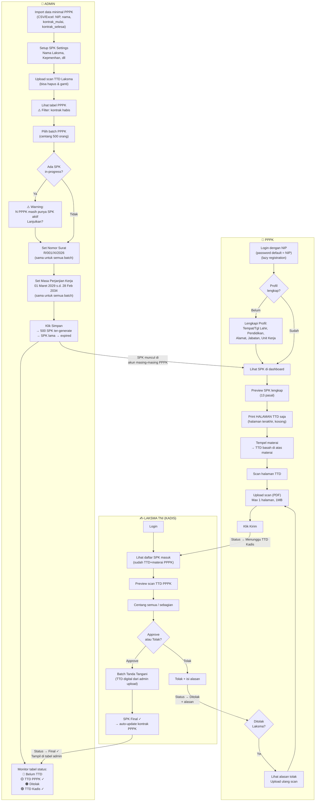
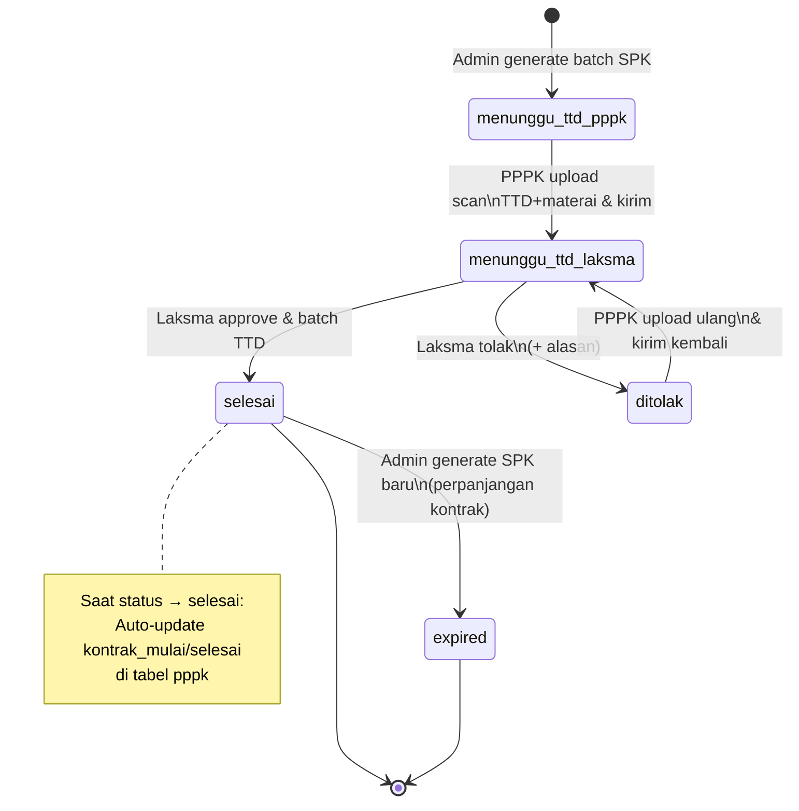
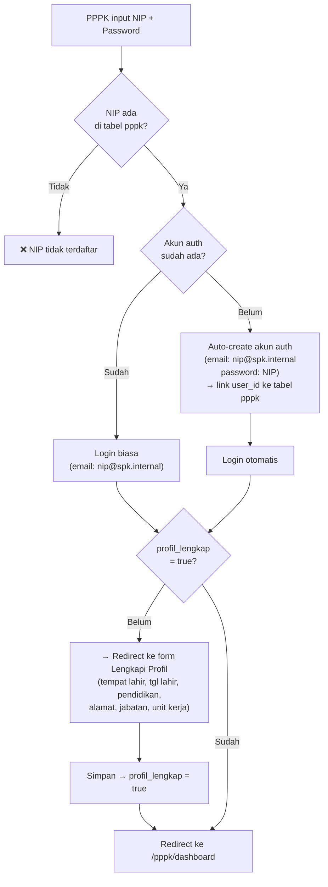
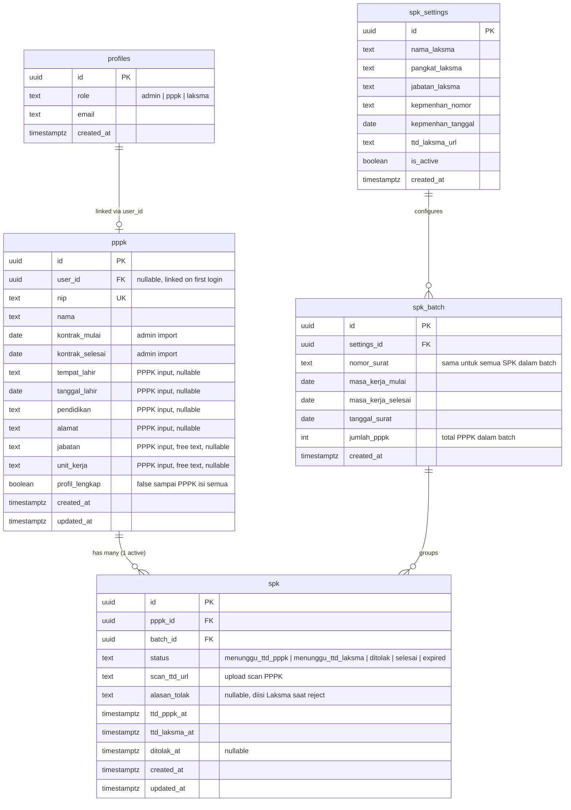

# 📋 Technical Plan (Final) — Aplikasi SPK PPPK Digital

> [!IMPORTANT]
> Plan final yang sudah disepakati. Semua keputusan sudah fix. Siap untuk coding.

---

## Rangkuman Semua Keputusan

| # | Topik | Keputusan |
|---|-------|-----------|
| 1 | Materai | **Tempel fisik** — PPPK print, tempel, TTD basah, scan, upload |
| 2 | TTD PPPK | **Scan upload (PDF)** — print halaman TTD → materai → TTD → scan → upload |
| 3 | TTD Laksma | **Upload scan gambar oleh admin** — applied digital saat batch approve |
| 4 | Nomor Surat | **Sama untuk seluruh batch** — admin set 1 nomor untuk semua PPPK dalam batch |
| 5 | Masa Perjanjian | **Batch set oleh admin** — sama untuk seluruh PPPK yang dipilih |
| 6 | Pasal 2-12 | **Statis/template** — hardcoded, ditampilkan di preview |
| 7 | Password PPPK | **Default = NIP** |
| 8 | 1 PPPK : 1 SPK | **1 SPK aktif**, SPK lama diarsipkan (expired) |
| 9 | PDF Final | **Tidak di-download** — tersimpan & dilihat di webapp saja |
| 10 | Role | **3 role**: Admin, PPPK, Laksma (terpisah) |
| 11 | Audit/Notifikasi | Tidak diperlukan saat ini |
| 12 | Nomor surat format | `R/___/XI/2026` (satu nomor di halaman depan) |
| 13 | Login NIP | **Email dummy** `{nip}@spk.internal` — user tetap login pakai NIP |
| 14 | Registrasi PPPK | **Lazy registration** — akun dibuat saat PPPK pertama kali login |
| 15 | Reject SPK | **Laksma bisa tolak + alasan** — SPK kembali ke PPPK untuk upload ulang |
| 16 | Generate overlap | **Warning** jika PPPK yang dipilih masih punya SPK aktif in-progress |
| 17 | UI | **Responsive** (mobile-friendly) |
| 18 | Validasi upload | Max **1 halaman**, max **1MB**, **PDF only**, bisa re-upload sebelum TTD Laksma |
| 19 | Auto-update kontrak | `kontrak_mulai/selesai` di tabel pppk **auto-update** saat SPK → selesai |
| 20 | Data PPPK | **Admin import minimal** (NIP, nama, kontrak_mulai, kontrak_selesai) → **PPPK lengkapi sendiri** (tempat lahir, tgl lahir, pendidikan, alamat, jabatan, unit kerja) saat pertama login |
| 21 | Jabatan & Unit Kerja | **Free text** — PPPK ketik sendiri |

---

## Tech Stack

| Layer | Teknologi |
|-------|-----------|
| Frontend | **Next.js 16 (App Router)** |
| UI Theme | **TailAdmin Free** (sudah ada di `free-nextjs-admin-dashboard-main/`) |
| Styling | **Tailwind CSS v4** (bawaan TailAdmin) |
| UI Components | **@base-ui/react + TailAdmin UI** (bukan shadcn/ui — TailAdmin punya component library sendiri) |
| Tables | **@tanstack/react-table v9** (bawaan TailAdmin) |
| Database & Auth | **Supabase (PostgreSQL)** |
| PDF | **@react-pdf/renderer** |
| Import | **papaparse** (CSV) / **xlsx** (Excel) |
| Forms | **React Hook Form + Zod** (bawaan TailAdmin) |
| i18n | **next-intl** (bawaan TailAdmin, opsional) |
| Icons | **TailAdmin TSX Icons** (`src/icons/`) |
| Charts | **ApexCharts** (bawaan TailAdmin, untuk dashboard) |

### TailAdmin — Komponen Bawaan yang Akan Dipakai

Template TailAdmin di `free-nextjs-admin-dashboard-main/` sudah menyediakan:

| Komponen Bawaan | Lokasi | Dipakai Untuk |
|-----------------|--------|---------------|
| Sidebar + Header Layout | `src/layout/app-layout/` | Layout semua role (admin, pppk, laksma) |
| Table component | `src/components/ui/table.tsx` | Tabel PPPK, tabel SPK |
| @tanstack/react-table | Built-in | Filter, sort, pagination tabel PPPK |
| Form elements (input, select, checkbox) | `src/components/ui/` | Form settings, form generate SPK |
| File input / Dropzone | `src/components/ui/file-input.tsx` + `react-dropzone` | Upload TTD Laksma, upload scan PPPK |
| Dialog / Modal | `src/components/ui/dialog.tsx` | Dialog reject, dialog konfirmasi batch |
| Badge | `src/components/ui/badge.tsx` | Status SPK (🔴🟠🟡🟢) |
| Pagination | `src/components/ui/pagination.tsx` | Pagination tabel PPPK |
| Tabs | `src/components/ui/tabs.tsx` | Tab filter di dashboard admin |
| Alert | `src/components/ui/alert.tsx` | Warning SPK in-progress, alasan reject |
| Spinner / Skeleton | `src/components/ui/spinner.tsx`, `skeleton.tsx` | Loading state |
| Switch / Toggle | `src/components/ui/switch.tsx` | Toggle settings |
| Tooltip | `src/components/ui/tooltip.tsx` | Info tooltips |
| Dark mode | `src/context/theme-context.tsx` | Tema gelap |
| Auth pages (signin) | `src/app/[locale]/(full-width-pages)/(auth)/` | Halaman login NIP |
| Dashboard metrics | `src/components/main/dashboard/ecommerce/metrics/` | Card total PPPK, kontrak habis, dll |
| Breadcrumb | `src/components/common/page-breadcrumb.tsx` | Navigasi halaman |

> [!IMPORTANT]
> **Tidak pakai shadcn/ui** — TailAdmin sudah punya UI component library lengkap berbasis `@base-ui/react`. Semua komponen UI akan menggunakan yang sudah tersedia di TailAdmin untuk konsistensi desain.

---

## Flow Lengkap



---

## Status Flow SPK



---

## Auth Flow — Login NIP + Lazy Registration



### Penjelasan:
1. PPPK input NIP + password di halaman login
2. Sistem cek apakah NIP ada di tabel `pppk` (dari import admin: NIP, nama, kontrak dates)
3. Jika belum punya akun auth → **auto-create** dengan email `{nip}@spk.internal` dan password = NIP
4. Link `user_id` di tabel `pppk` ke akun auth yang baru dibuat
5. **Cek profil lengkap** — jika belum, redirect ke form profil
6. PPPK isi: tempat/tgl lahir, pendidikan, alamat, jabatan, unit kerja
7. Setelah profil lengkap → redirect ke dashboard PPPK

> [!NOTE]
> Pertama kali login, password = NIP. PPPK bisa ganti password nanti jika diperlukan (fitur optional).

---

## Database Schema (Final)



### Penjelasan Relasi

```
spk_settings (1) ──→ (N) spk_batch ──→ (N) spk ←── (1) pppk
      │                      │                │
  Data Laksma          Nomor surat        Status per PPPK
  Kepmenhan            Masa perjanjian    Scan TTD upload
  TTD Laksma           Tanggal surat     Alasan tolak
```

---

## SQL Migrations

```sql
-- 1. Profiles (extends Supabase Auth)
CREATE TABLE profiles (
  id UUID PRIMARY KEY REFERENCES auth.users(id) ON DELETE CASCADE,
  role TEXT NOT NULL CHECK (role IN ('admin', 'pppk', 'laksma')),
  email TEXT,
  created_at TIMESTAMPTZ DEFAULT NOW()
);

-- 2. Data master PPPK
-- Admin import: nip, nama, kontrak_mulai, kontrak_selesai
-- PPPK input sendiri: tempat_lahir, tanggal_lahir, pendidikan, alamat, jabatan, unit_kerja
CREATE TABLE pppk (
  id UUID PRIMARY KEY DEFAULT gen_random_uuid(),
  user_id UUID REFERENCES profiles(id),
  nip TEXT UNIQUE NOT NULL,
  nama TEXT NOT NULL,
  kontrak_mulai DATE NOT NULL,
  kontrak_selesai DATE NOT NULL,
  -- Diisi oleh PPPK saat pertama login (nullable)
  tempat_lahir TEXT,
  tanggal_lahir DATE,
  pendidikan TEXT,
  alamat TEXT,
  jabatan TEXT,                         -- free text, diisi PPPK
  unit_kerja TEXT,                      -- free text, diisi PPPK
  profil_lengkap BOOLEAN DEFAULT FALSE, -- true setelah PPPK isi semua field
  created_at TIMESTAMPTZ DEFAULT NOW(),
  updated_at TIMESTAMPTZ DEFAULT NOW()
);

-- 3. Pengaturan SPK (data Laksma, Kepmenhan)
CREATE TABLE spk_settings (
  id UUID PRIMARY KEY DEFAULT gen_random_uuid(),
  nama_laksma TEXT NOT NULL,
  pangkat_laksma TEXT NOT NULL DEFAULT 'Laksamana Pertama TNI',
  jabatan_laksma TEXT NOT NULL DEFAULT 'Kadisminpersal',
  kepmenhan_nomor TEXT NOT NULL,
  kepmenhan_tanggal DATE NOT NULL,
  ttd_laksma_url TEXT,
  is_active BOOLEAN DEFAULT TRUE,
  created_at TIMESTAMPTZ DEFAULT NOW()
);

-- 4. Batch SPK (1 batch = 1x admin klik simpan)
CREATE TABLE spk_batch (
  id UUID PRIMARY KEY DEFAULT gen_random_uuid(),
  settings_id UUID NOT NULL REFERENCES spk_settings(id),
  nomor_surat TEXT NOT NULL,
  masa_kerja_mulai DATE NOT NULL,
  masa_kerja_selesai DATE NOT NULL,
  tanggal_surat DATE NOT NULL,
  jumlah_pppk INT NOT NULL DEFAULT 0,
  created_at TIMESTAMPTZ DEFAULT NOW()
);

-- 5. SPK individual per PPPK
CREATE TABLE spk (
  id UUID PRIMARY KEY DEFAULT gen_random_uuid(),
  pppk_id UUID NOT NULL REFERENCES pppk(id),
  batch_id UUID NOT NULL REFERENCES spk_batch(id),
  status TEXT NOT NULL DEFAULT 'menunggu_ttd_pppk'
    CHECK (status IN ('menunggu_ttd_pppk', 'menunggu_ttd_laksma', 'ditolak', 'selesai', 'expired')),
  scan_ttd_url TEXT,
  alasan_tolak TEXT,
  ttd_pppk_at TIMESTAMPTZ,
  ttd_laksma_at TIMESTAMPTZ,
  ditolak_at TIMESTAMPTZ,
  created_at TIMESTAMPTZ DEFAULT NOW(),
  updated_at TIMESTAMPTZ DEFAULT NOW()
);

-- Constraint: 1 PPPK = 1 SPK aktif (bukan expired)
CREATE UNIQUE INDEX idx_spk_active_per_pppk
ON spk (pppk_id)
WHERE status != 'expired';

-- Index untuk performa
CREATE INDEX idx_pppk_kontrak_selesai ON pppk (kontrak_selesai);
CREATE INDEX idx_pppk_nip ON pppk (nip);
CREATE INDEX idx_spk_status ON spk (status);
CREATE INDEX idx_spk_batch_id ON spk (batch_id);

-- Function: Auto-update kontrak saat SPK selesai
CREATE OR REPLACE FUNCTION update_kontrak_on_spk_selesai()
RETURNS TRIGGER AS $$
BEGIN
  IF NEW.status = 'selesai' AND OLD.status != 'selesai' THEN
    UPDATE pppk
    SET
      kontrak_mulai = (SELECT masa_kerja_mulai FROM spk_batch WHERE id = NEW.batch_id),
      kontrak_selesai = (SELECT masa_kerja_selesai FROM spk_batch WHERE id = NEW.batch_id),
      updated_at = NOW()
    WHERE id = NEW.pppk_id;
  END IF;
  RETURN NEW;
END;
$$ LANGUAGE plpgsql;

CREATE TRIGGER trg_update_kontrak
AFTER UPDATE ON spk
FOR EACH ROW
EXECUTE FUNCTION update_kontrak_on_spk_selesai();
```

---

## Row Level Security (RLS)

```sql
-- Enable RLS on all tables
ALTER TABLE profiles ENABLE ROW LEVEL SECURITY;
ALTER TABLE pppk ENABLE ROW LEVEL SECURITY;
ALTER TABLE spk_settings ENABLE ROW LEVEL SECURITY;
ALTER TABLE spk_batch ENABLE ROW LEVEL SECURITY;
ALTER TABLE spk ENABLE ROW LEVEL SECURITY;

-- Helper function: get current user role
CREATE OR REPLACE FUNCTION get_user_role()
RETURNS TEXT AS $$
  SELECT role FROM profiles WHERE id = auth.uid();
$$ LANGUAGE sql SECURITY DEFINER;

-- PROFILES
CREATE POLICY profiles_own ON profiles
  FOR SELECT USING (id = auth.uid());

-- PPPK
CREATE POLICY pppk_admin_all ON pppk
  FOR ALL USING (get_user_role() = 'admin');

CREATE POLICY pppk_own_select ON pppk
  FOR SELECT USING (user_id = auth.uid());

CREATE POLICY pppk_own_update ON pppk
  FOR UPDATE USING (user_id = auth.uid())
  WITH CHECK (user_id = auth.uid());

CREATE POLICY pppk_laksma_select ON pppk
  FOR SELECT USING (get_user_role() = 'laksma');

-- SPK_SETTINGS
CREATE POLICY settings_admin_all ON spk_settings
  FOR ALL USING (get_user_role() = 'admin');

CREATE POLICY settings_read ON spk_settings
  FOR SELECT USING (TRUE);  -- semua role bisa baca settings

-- SPK_BATCH
CREATE POLICY batch_admin_all ON spk_batch
  FOR ALL USING (get_user_role() = 'admin');

CREATE POLICY batch_read ON spk_batch
  FOR SELECT USING (TRUE);

-- SPK
CREATE POLICY spk_admin_all ON spk
  FOR ALL USING (get_user_role() = 'admin');

CREATE POLICY spk_pppk_select ON spk
  FOR SELECT USING (
    pppk_id IN (SELECT id FROM pppk WHERE user_id = auth.uid())
  );

CREATE POLICY spk_pppk_update ON spk
  FOR UPDATE USING (
    pppk_id IN (SELECT id FROM pppk WHERE user_id = auth.uid())
    AND status IN ('menunggu_ttd_pppk', 'ditolak', 'menunggu_ttd_laksma')
  );

CREATE POLICY spk_laksma_select ON spk
  FOR SELECT USING (
    get_user_role() = 'laksma'
    AND status IN ('menunggu_ttd_laksma', 'selesai')
  );

CREATE POLICY spk_laksma_update ON spk
  FOR UPDATE USING (
    get_user_role() = 'laksma'
    AND status = 'menunggu_ttd_laksma'
  );
```

---

## Upload Validation Rules

| Rule | Nilai |
|------|-------|
| Format | **PDF only** |
| Max size | **1 MB** |
| Max halaman | **1 halaman** |
| Re-upload | Boleh selama status `menunggu_ttd_pppk`, `ditolak`, atau `menunggu_ttd_laksma` |
| Re-upload setelah TTD Laksma | **Tidak boleh** (SPK sudah final) |

### Validasi di Frontend & Backend

```
Frontend:
  - Cek file type === 'application/pdf'
  - Cek file.size <= 1 * 1024 * 1024 (1MB)
  - Preview PDF sebelum upload

Backend (API route):
  - Validasi ulang type & size
  - Parse PDF, cek jumlah halaman === 1
  - Upload ke Supabase Storage
  - Update spk.scan_ttd_url
```

---

## Wireframe UI

### Admin — Dashboard & Tabel PPPK

```
┌─────────────────────────────────────────────────────────────────────────────┐
│  📊 Dashboard Admin                                                         │
│                                                                             │
│  ┌──────────┐  ┌──────────────────┐  ┌────────────────┐  ┌──────────────┐  │
│  │   1.200   │  │  🔴 500          │  │  🟡 200        │  │  🟢 500      │  │
│  │ Total PPPK│  │ Kontrak Habis    │  │ Habis < 3 bln  │  │  Aktif       │  │
│  └──────────┘  └──────────────────┘  └────────────────┘  └──────────────┘  │
├─────────────────────────────────────────────────────────────────────────────┤
│                                                                             │
│  Filter: [Status Kontrak ▾] [Unit Kerja ▾] [Status SPK ▾] [🔍 Cari NIP..] │
│                                                                             │
│  ☑ Pilih Semua (terfilter)                                                  │
│  ┌───┬──────────────────┬──────────────────┬────────────┬─────────┬───────┐ │
│  │ ☑ │ NIP              │ Nama             │ Kontrak    │ Kontrak │Status │ │
│  │   │                  │                  │ Selesai    │         │ SPK   │ │
│  ├───┼──────────────────┼──────────────────┼────────────┼─────────┼───────┤ │
│  │ ☑ │ 19901118202321.. │ dr. Chendy F.    │ 28/02/2029 │ 🔴 Habis│  —   │ │
│  │ ☑ │ 19850510202321.. │ Budi Santoso     │ 01/03/2029 │ 🟡 <3bl │  —   │ │
│  │ ☐ │ 19920315202321.. │ Siti Aminah      │ 15/12/2030 │ 🟢 Aktif│ 🟢   │ │
│  │ ☑ │ 19910722202321.. │ Ahmad Rizky      │ 28/02/2029 │ 🔴 Habis│ 🟠   │ │
│  └───┴──────────────────┴──────────────────┴────────────┴─────────┴───────┘ │
│                                                                             │
│  ── Generate SPK untuk 500 PPPK yang dipilih ────────────────────────────── │
│                                                                             │
│  ⚠️ 50 PPPK yang dipilih masih punya SPK aktif (akan di-expired)           │
│                                                                             │
│  Nomor Surat        : [ R/001/XI/2026              ]                        │
│  Masa Perjanjian    : [ 01 Maret 2029 ] s.d. [ 28 Februari 2034 ]          │
│  Tanggal Surat      : [ 01 Maret 2029 ]                                    │
│                                                                             │
│                                          [ 💾 Simpan & Generate 500 SPK ]   │
└─────────────────────────────────────────────────────────────────────────────┘

Status SPK Legend:
  —  = Belum ada SPK
  🔴 = Menunggu TTD PPPK
  🟠 = Ditolak (PPPK perlu upload ulang)
  🟡 = Menunggu TTD Kadis
  🟢 = Final (selesai)
```

### Admin — SPK Settings

```
┌─────────────────────────────────────────────────────────────┐
│  ⚙️ Pengaturan SPK                                          │
│                                                             │
│  Nama Laksma TNI    : [ Bambang Wasito, S.E., M.Han.    ]  │
│  Pangkat            : [ Laksamana Pertama TNI            ]  │
│  Jabatan            : [ Kadisminpersal                   ]  │
│  Kepmenhan Nomor    : [ KEP/273/II/2024                  ]  │
│  Kepmenhan Tanggal  : [ 28 Februari 2024                 ]  │
│                                                             │
│  TTD Laksma:                                                │
│  ┌──────────────────────┐                                   │
│  │                      │                                   │
│  │   [gambar TTD scan]  │  [🗑️ Hapus] [📤 Upload Baru]     │
│  │                      │                                   │
│  └──────────────────────┘                                   │
│                                                             │
│                                    [ 💾 Simpan ]            │
└─────────────────────────────────────────────────────────────┘
```

### PPPK — Form Lengkapi Profil (Muncul jika profil_lengkap = false)

```
┌─────────────────────────────────────────────────────────────┐
│  👤 Lengkapi Data Profil PPPK                               │
│                                                             │
│  Data dari Admin:                                           │
│  NIP                 : 199011182023212031 (Read Only)       │
│  Nama                : dr. Chendy Fiollitha S. (Read Only)  │
│                                                             │
│  ── Harap Lengkapi Data Berikut Sebelum Melanjutkan ──────  │
│                                                             │
│  Tempat Lahir        : [ Balikpapan                       ] │
│  Tanggal Lahir       : [ 18 November 1990                 ] │
│  Pendidikan          : [ S-1 Profesi Dokter Umum          ] │
│  Alamat              : [ Jl. Lembah Hijau RT/RW 002/013... ] │
│  Jabatan             : [ Dokter Ahli Pertama              ] │
│  Unit Kerja          : [ Rumkital dr. Azhar Zahir Manok... ]│
│                                                             │
│                                    [ 💾 Simpan Profil ]     │
└─────────────────────────────────────────────────────────────┘
```

### PPPK — Dashboard (Normal)

```
┌─────────────────────────────────────────────────────────────┐
│  📝 SPK Anda                                                │
│                                                             │
│  Status: 🔴 Menunggu Tanda Tangan Anda                      │
│                                                             │
│  Nomor Surat       : R/001/XI/2026                          │
│  Masa Perjanjian   : 01 Maret 2029 s.d. 28 Februari 2034   │
│  Jabatan           : Dokter Ahli Pertama                    │
│  Unit Kerja        : Rumkital dr. Azhar Zahir Manokwari     │
│                                                             │
│  [ 👁️ Preview SPK Lengkap ]  [ 🖨️ Print Halaman TTD ]      │
│                                                             │
│  ── Upload Scan TTD + Materai ────────────────────────────  │
│                                                             │
│  ┌──────────────────────────────────────────┐               │
│  │                                          │               │
│  │   Drag & drop file PDF scan di sini      │               │
│  │   atau klik untuk pilih file             │               │
│  │   (Format: PDF, Max: 1MB, 1 halaman)    │               │
│  │                                          │               │
│  └──────────────────────────────────────────┘               │
│                                                             │
│  [ Preview Upload ]                                         │
│                                                             │
│                                    [ 📤 Kirim ]             │
└─────────────────────────────────────────────────────────────┘
```

### PPPK — Dashboard (Ditolak)

```
┌─────────────────────────────────────────────────────────────┐
│  📝 SPK Anda                                                │
│                                                             │
│  Status: 🟠 Ditolak — Perlu Upload Ulang                    │
│                                                             │
│  ┌────────────────────────────────────────────────────────┐ │
│  │ ❌ Alasan Penolakan:                                    │ │
│  │ "Scan tidak jelas, tanda tangan tidak terlihat.        │ │
│  │  Mohon scan ulang dengan resolusi lebih tinggi."       │ │
│  │                                        — Kadisminpersal │ │
│  └────────────────────────────────────────────────────────┘ │
│                                                             │
│  Nomor Surat       : R/001/XI/2026                          │
│  Masa Perjanjian   : 01 Maret 2029 s.d. 28 Februari 2034   │
│                                                             │
│  ── Upload Ulang Scan TTD + Materai ─────────────────────  │
│                                                             │
│  ┌──────────────────────────────────────────┐               │
│  │                                          │               │
│  │   Drag & drop file PDF scan di sini      │               │
│  │   (Format: PDF, Max: 1MB, 1 halaman)    │               │
│  │                                          │               │
│  └──────────────────────────────────────────┘               │
│                                                             │
│                                    [ 📤 Kirim Ulang ]       │
└─────────────────────────────────────────────────────────────┘
```

### Laksma TNI — Batch TTD & Reject

```
┌─────────────────────────────────────────────────────────────────────────┐
│  ✍️ SPK Menunggu Tanda Tangan                        Total: 487        │
│                                                                         │
│  ☑ Pilih Semua                                                          │
│  ┌───┬──────────────────┬──────────────────┬────────┬─────────────────┐ │
│  │ ☑ │ NIP              │ Nama             │ Batch  │ Aksi            │ │
│  ├───┼──────────────────┼──────────────────┼────────┼─────────────────┤ │
│  │ ☑ │ 19901118202321.. │ dr. Chendy F.    │ R/001  │ [👁️] [❌ Tolak] │ │
│  │ ☑ │ 19850510202321.. │ Budi Santoso     │ R/001  │ [👁️] [❌ Tolak] │ │
│  │ ☐ │ 19910722202321.. │ Ahmad Rizky      │ R/001  │ [👁️] [❌ Tolak] │ │
│  └───┴──────────────────┴──────────────────┴────────┴─────────────────┘ │
│                                                                         │
│  [ ✍️ Tanda Tangani 486 SPK yang dipilih ]                              │
│                                                                         │
│  ── Dialog Tolak ─────────────────────────────────────────────────────  │
│  │ Alasan penolakan:                                                  │ │
│  │ [ Scan tidak jelas, mohon upload ulang...                        ] │ │
│  │                                           [ Batal ] [ ❌ Tolak ]   │ │
│  └────────────────────────────────────────────────────────────────────  │
└─────────────────────────────────────────────────────────────────────────┘
```

---

## PDF Strategy

### Yang Di-Generate Sistem

| PDF | Konten | Untuk Siapa |
|-----|--------|-------------|
| **SPK Preview** | 10 halaman lengkap, semua TTD kosong | PPPK lihat di webapp |
| **Halaman TTD (print)** | Halaman 10 saja, TTD kosong, ada teks "Meterai Rp.10.000,-" | PPPK download & print |

### Yang Di-Upload PPPK

| File | Konten | Format | Validasi |
|------|--------|--------|----------|
| **Scan halaman TTD** | Halaman 10 yang sudah ditempel materai + TTD basah | PDF | Max 1 hal, 1MB |

### Arsip Digital di Webapp

Ketika SPK status `selesai`, webapp menampilkan:
- **Preview SPK** (generated, 13 pasal) — halaman 1-9
- **Scan TTD PPPK** (uploaded PDF) — halaman TTD dengan materai + TTD PPPK
- **TTD Laksma** — badge "Ditandatangani oleh [Nama Laksma] pada [tanggal]"
- **Status: ✅ Final**

---

## Supabase Storage

```
storage/
├── signatures/
│   └── laksma/
│       └── {settings_id}.png         ← Scan TTD Laksma (admin upload)
└── scans/
    └── {spk_id}.pdf                  ← Scan halaman TTD PPPK (PDF, max 1MB)
```

---

## Daftar Halaman & Komponen

### Routes

```
/login                          ← Login (NIP + password, lazy registration)

/admin/dashboard                ← Ringkasan & warning kontrak habis
/admin/settings                 ← SPK settings + TTD Laksma
/admin/pppk                     ← Tabel PPPK + import + filter + status SPK
/admin/pppk/import              ← Upload CSV/Excel

/pppk/dashboard                 ← SPK aktif + status + alasan tolak (jika ditolak)
/pppk/profile                   ← Lengkapi data profil (tempat lahir, jabatan, unit kerja, dll)
/pppk/spk                      ← Preview SPK + print halaman TTD
/pppk/spk/upload                ← Upload scan + kirim

/laksma/dashboard               ← Summary
/laksma/spk                     ← List SPK masuk + batch TTD + tolak individual
```

### Shared Components (Extend dari TailAdmin)

```
components/
├── ui/                         ← TailAdmin UI (sudah ada, extend jika perlu)
├── spk/
│   ├── SpkPreview.tsx          ← Preview SPK 13 pasal (rendered in browser)
│   ├── SpkSignaturePage.tsx    ← Halaman TTD untuk print (PDF)
│   ├── SpkStatusBadge.tsx      ← 🔴🟠🟡🟢 badge
│   └── KontrakBadge.tsx        ← Badge status kontrak
├── admin/
│   ├── PppkTable.tsx           ← Tabel PPPK dengan filter & checkbox & pagination
│   ├── BatchGenerateForm.tsx   ← Form nomor surat + masa perjanjian + warning
│   ├── ImportDialog.tsx        ← Upload & validate CSV/Excel
│   └── SettingsForm.tsx        ← Form settings + upload TTD Laksma
├── pppk/
│   ├── ProfileForm.tsx         ← Form lengkapi profil (tempat/tgl lahir, jabatan, unit kerja)
│   ├── ScanUploader.tsx        ← Upload scan PDF + preview + validasi
│   ├── SpkCard.tsx             ← Card SPK di dashboard PPPK
│   └── RejectAlert.tsx         ← Alert alasan penolakan
└── laksma/
    ├── SpkList.tsx             ← List SPK + checkbox batch
    ├── BatchSignDialog.tsx     ← Konfirmasi batch TTD
    └── RejectDialog.tsx        ← Dialog input alasan tolak
```

---

## Fase Development

### Fase 1 — Foundation (Minggu 1-2)
- [ ] Setup project dari TailAdmin template (`free-nextjs-admin-dashboard-main/`)
- [ ] Install & konfigurasi Supabase client (`@supabase/supabase-js`, `@supabase/ssr`)
- [ ] Database schema & migrations (semua tabel + trigger + index)
- [ ] Auth: login NIP dengan lazy registration (custom login page dari TailAdmin auth template)
- [ ] RLS policies
- [ ] Kustomisasi sidebar navigation per role (Admin, PPPK, Laksma)
- [ ] Middleware role-based routing
- [ ] Adaptasi TailAdmin layout untuk 3 dashboard role

### Fase 2 — Core Features (Minggu 3-4)
- [ ] Admin: SPK settings CRUD + upload TTD Laksma
- [ ] Admin: Import PPPK minimal (CSV/Excel: NIP, Nama, Kontrak) + tabel dengan filter & pagination
- [ ] Admin: Batch generate SPK (nomor surat + masa perjanjian + warning overlap)
- [ ] Admin: Status tracking di tabel (🔴🟠🟡🟢)
- [ ] PPPK: Form lengkapi profil mandiri (tempat/tgl lahir, pendidikan, alamat, jabatan, unit kerja)
- [ ] PPPK: Dashboard + preview SPK + print halaman TTD
- [ ] PPPK: Upload scan PDF (validasi 1 hal, 1MB) + kirim

### Fase 3 — Laksma & Polish (Minggu 5-6)
- [ ] Laksma: Dashboard + list SPK masuk
- [ ] Laksma: Preview scan PPPK + batch TTD
- [ ] Laksma: Reject individual + alasan
- [ ] PPPK: Tampilan ditolak + alasan + upload ulang
- [ ] Warning system kontrak habis (badge, filter)
- [ ] SPK expired (arsip SPK lama saat generate baru)
- [ ] Auto-update kontrak saat SPK selesai (trigger)
- [ ] Testing & bug fixing

---

## Roadmap Future (Tidak Termasuk Scope Sekarang)
- TTD Barcode / QR Code
- E-Materai API integration
- Notifikasi (email/WA)
- Audit trail
- Download PDF massal (ZIP)
- Dashboard analytics (pakai ApexCharts bawaan TailAdmin)
- Ganti password PPPK
- Multi-language (pakai next-intl bawaan TailAdmin)
